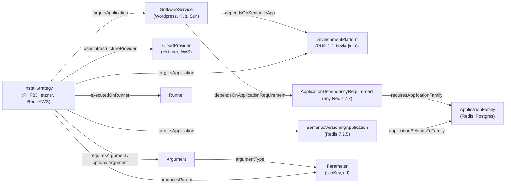
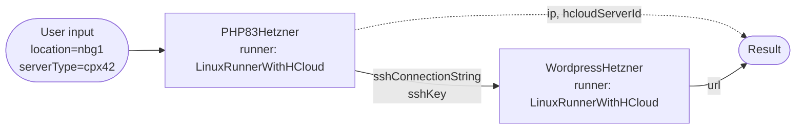
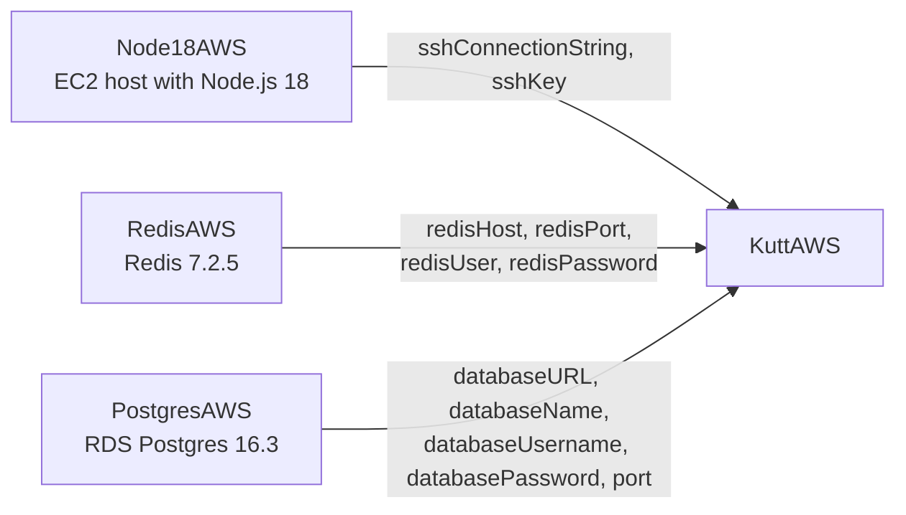

# From "I want X" to a running service: discover, identify, deploy

This example walks through the definitions that already exist under [`ontology/`](../ontology) and shows how they answer three questions:

1. **Discover**: what services are described, and what do they need?
2. **Identify**: which install strategies can satisfy those needs on a given infrastructure provider, and how do they fit together?
3. **Deploy**: what runs, where, with which inputs, and what comes out?

Every entity, property and query result below comes from the current Turtle files, and every query was run against them.

## Table of contents

- [The model in one picture](#the-model-in-one-picture)
- [Running the queries yourself](#running-the-queries-yourself)
- [Walkthrough 1: WordPress on Hetzner](#walkthrough-1-wordpress-on-hetzner)
- [Walkthrough 2: Kutt on AWS](#walkthrough-2-kutt-on-aws)
- [How the SPM tooling uses this](#how-the-spm-tooling-uses-this)
- [Where each definition lives](#where-each-definition-lives)

## The model in one picture

The ontology separates **what** you want to run from **how** and **where** it gets installed.



The key idea is in the last three edges: **a strategy's outputs and another strategy's inputs are typed by the same `spm:Parameter`**. If one strategy produces `spm_params:sshKey` and another requires an argument of type `spm_params:sshKey`, they can be chained. Nothing has to be hard-coded between them.

## Running the queries yourself

Every query below is SPARQL. To reproduce the results, load the whole `ontology/` folder into any RDF store. A minimal Python setup:

```bash
python3 -m venv .venv && .venv/bin/pip install rdflib
```

```python
import glob
from rdflib import Graph

g = Graph()
for path in glob.glob("ontology/**/*.ttl", recursive=True):
    g.parse(path, format="turtle")

PREFIXES = """
PREFIX dcterms: <http://purl.org/dc/terms/>
PREFIX spm: <http://the-spm.org/schema#>
"""

def run(query):
    for row in g.query(PREFIXES + query):
        print(" | ".join("" if v is None else str(v) for v in row))
```

Queries below omit the `PREFIX` lines for brevity. Full IRIs such as `<http://the-spm.org/entities/services#Wordpress>` are written out so that each query can be copied as-is.

## Walkthrough 1: WordPress on Hetzner

The goal: *"I want a WordPress site, and I want it on Hetzner Cloud."*

### Step 1: discover what services exist

```sparql
SELECT ?service ?title ?version ?platform WHERE {
  ?service a spm:SoftwareService ;
           dcterms:title ?title ;
           spm:hasSemanticVersion ?version .
  OPTIONAL { ?service spm:dependsOnSemanticApp/dcterms:title ?platform }
}
ORDER BY ?title
```

| Service | Version | Runs on |
|---------|---------|---------|
| Kutt | 2.7.4 | Node.js 18 |
| Suri | 0.5.1 | Node.js 18 |
| Wordpress | 7.0 | PHP 8.3 |

WordPress is described in [`entities/service.ttl`](../ontology/entities/service.ttl):

```turtle
spm_services:Wordpress a spm:SoftwareService ;
    dcterms:title "Wordpress" ;
    spm:hasSemanticVersion "7.0" ;
    spm:dependsOnSemanticApp spm_platforms:PHP83 ;
    spm:downloadURL "https://wordpress.org/wordpress-7.0.zip" ;
    dcterms:description "WordPress is a web content management system. ..." .
```

So before WordPress can be installed, something has to provide **PHP 8.3**. That platform is defined in [`entities/platforms.ttl`](../ontology/entities/platforms.ttl), with its release and end-of-life dates (`2023-11-23` and `2027-12-31`). A tool can use those dates to warn about unsupported platforms.

### Step 2: identify strategies for the service and its dependencies

Look for install strategies that target either WordPress itself or anything WordPress depends on:

```sparql
SELECT ?strategy ?title ?targets ?infra WHERE {
  { BIND(<http://the-spm.org/entities/services#Wordpress> AS ?app) }
  UNION
  { <http://the-spm.org/entities/services#Wordpress> spm:dependsOnSemanticApp ?app . }
  ?strategy spm:targetsApplication ?app ;
            dcterms:title ?title .
  ?app dcterms:title ?targets .
  OPTIONAL { ?strategy spm:usesInfrastructureProvider/dcterms:title ?infra }
}
ORDER BY ?targets ?infra
```

| Strategy | Installs | Provider |
|----------|----------|----------|
| `PHP83Hetzner`: Install PHP 8.3 on Hetzner | PHP 8.3 | Hetzner Cloud |
| `WordpressHetzner`: Install Wordpress on Hetzner | Wordpress | Hetzner Cloud |

The two strategies together form the install plan: first a PHP host, then WordPress on top of it.

### Step 3: pick arguments from the allowed values

`PHP83Hetzner` has two **optional** arguments. Both restrict their values to entities defined in the ontology, so a UI or CLI can offer a dropdown instead of free text:

```sparql
SELECT ?name ?type ?description (COUNT(?allowed) AS ?allowedCount) WHERE {
  <http://the-spm.org/entities/install_strategies#PHP83Hetzner> spm:optionalArgument ?arg .
  ?arg spm:argumentName ?name ;
       spm:argumentType ?type ;
       spm:argumentDescription ?description .
  OPTIONAL { ?arg spm:allowedValues ?allowed }
}
GROUP BY ?name ?type ?description
```

| Argument | Parameter type | Allowed values | Description |
|----------|----------------|----------------|-------------|
| `location` | `spm_params:hetznerLocation` | 6 | Defaults to `fsn1` |
| `serverType` | `spm_params:serverType` | 17 | Defaults to `cpx32` |

The allowed values are full entities with their own properties, not just strings. The locations:

```sparql
SELECT ?id ?title WHERE {
  <http://the-spm.org/entities/install_strategies#PHP83HetznerLocation> spm:allowedValues ?loc .
  ?loc spm:hetznerLocationName ?id ;
       dcterms:title ?title .
}
ORDER BY ?id
```

`ash` (Ashburn), `fsn1` (Falkenstein), `hel1` (Helsinki), `hil` (Hillsboro), `nbg1` (Nuremberg), `sin` (Singapore).

Server types carry their specs, so you can filter by capacity. For example, *"at least 4 cores"*:

```sparql
SELECT ?id ?cores ?memory ?disk ?cpu WHERE {
  <http://the-spm.org/entities/install_strategies#PHP83HetznerServerType> spm:allowedValues ?st .
  ?st spm:serverTypeName ?id ;
      spm:serverTypeCores ?cores ;
      spm:serverTypeMemoryGB ?memory ;
      spm:serverTypeDiskGB ?disk ;
      spm:serverTypeCpuType ?cpu .
  FILTER(?cores >= 4)
}
ORDER BY ?cores ?memory ?id
```

| Server type | Cores | Memory (GB) | Disk (GB) | CPU |
|-------------|-------|-------------|-----------|-----|
| cpx31 | 4 | 8 | 160 | shared |
| cpx32 | 4 | 8 | 160 | shared |
| ccx23 | 4 | 16 | 160 | dedicated |
| cpx41 | 8 | 16 | 240 | shared |
| cpx42 | 8 | 16 | 320 | shared |
| ccx33 | 8 | 32 | 240 | dedicated |
| ... | | | | |

### Step 4: wire outputs to inputs

`WordpressHetzner` **requires** an SSH connection string and an SSH key. Ask which Hetzner strategy produces those parameter types:

```sparql
SELECT ?param ?producer WHERE {
  <http://the-spm.org/entities/install_strategies#WordpressHetzner>
      spm:requiresArgument/spm:argumentType ?param .
  OPTIONAL {
    ?producer spm:producesParam ?param ;
              spm:usesInfrastructureProvider <http://the-spm.org/entities/cloud_providers#Hetzner> .
  }
}
```

| Required parameter | Produced by |
|--------------------|-------------|
| `spm_params:sshConnectionString` | `PHP83Hetzner` |
| `spm_params:sshKey` | `PHP83Hetzner` |

This confirms the order: `PHP83Hetzner` must run first, because its outputs are `WordpressHetzner`'s inputs.

### Step 5: deploy

Everything needed to execute the plan is also in the graph:



| | `PHP83Hetzner` | `WordpressHetzner` |
|-|----------------|--------------------|
| Runner | `LinuxRunnerWithHCloud` (needs the hcloud CLI) | `LinuxRunnerWithHCloud` |
| Script | [`PHP83Hetzner/install.sh`](https://raw.githubusercontent.com/KyrtTech/spm.install_strategies/master/PHP83Hetzner/install.sh) | [`WordpressHetzner/install.sh`](https://raw.githubusercontent.com/KyrtTech/spm.install_strategies/master/WordpressHetzner/install.sh) |
| Inputs | optional `location`, `serverType` | required `sshConnectionString`, `sshKey`; optional `domain` |
| Outputs | `sshConnectionString`, `sshKey`, `ip`, `hcloudServerId` | `url` |

The runner definition in [`entities/runner.ttl`](../ontology/entities/runner.ttl) states what the machine executing the scripts must have:

```turtle
spm_runners:LinuxRunnerWithHCloud a spm:Runner ;
    spm:runsOnOperatingSystem spm_os:macOSMonterey, spm_os:Ubuntu2310, spm_os:Ubuntu2304, spm_os:Ubuntu2204LTS, spm_os:Ubuntu2004LTS ;
    spm:supportsApplication spm_apps:HCloudCli .
```

With the SPM runner, the whole flow above is one command. Use `--dry` to print the resolved plan without executing anything:

```bash
spm_runner install --application Wordpress --infra Hetzner --dry
```

Optional arguments are passed with `--user-params`, keyed by strategy IRI and argument name:

```json
{
  "http://the-spm.org/entities/install_strategies#PHP83Hetzner": {
    "location":   { "type": "inline", "payload": "nbg1",  "export": "env" },
    "serverType": { "type": "inline", "payload": "cpx42", "export": "env" }
  }
}
```

```bash
spm_runner install --application Wordpress --infra Hetzner --user-params ./params.json
```

## Walkthrough 2: Kutt on AWS

WordPress has one direct dependency. [Kutt](https://github.com/thedevs-network/kutt), a URL shortener, shows what happens when a service needs several other systems, with version ranges and sizing requirements.

### Discover: what Kutt needs

```turtle
spm_services:Kutt a spm:SoftwareService ;
    dcterms:title "Kutt" ;
    spm:hasSemanticVersion "2.7.4" ;
    spm:dependsOnSemanticApp spm_platforms:NodeJS18 ;
    spm:dependsOnApplicationRequirement spm_services:KuttRedisRequirement, spm_services:KuttPostgresRequirement ;
    spm:serviceHasDependencyParameter spm_services:KuttNodeJS18vCPU, spm_services:KuttNodeJS18Storage, spm_services:KuttPostgresvCPU, spm_services:KuttPostgresStorage ;
    ...

spm_services:KuttRedisRequirement a spm:ApplicationDependencyRequirement ;
    spm:requiresApplicationFamily spm_apps:Redis ;
    spm:versionConstraint ">=7.0.0 <8.0.0" .
```

Kutt depends on three things, expressed in two different ways:

- **A specific platform**: Node.js 18, via `dependsOnSemanticApp`.
- **Application families with a version range**: any Redis `>=7.0.0 <8.0.0` and any Postgres `>=16.0.0 <17.0.0`, via `dependsOnApplicationRequirement`. Kutt does not pin "Redis 7.2.5"; it states what it is compatible with.

It also declares **sizing**, i.e. how much compute each dependency should get:

```sparql
SELECT ?param ?forApp ?forFamily ?min ?recommended WHERE {
  <http://the-spm.org/entities/services#Kutt> spm:serviceHasDependencyParameter ?dep .
  ?dep spm:onParameter ?param ;
       spm:minValue ?min ;
       spm:recommendedValue ?recommended .
  OPTIONAL { ?dep spm:onApplication/dcterms:title ?forApp }
  OPTIONAL { ?dep spm:onApplicationRequirement/spm:requiresApplicationFamily/dcterms:title ?forFamily }
}
```

| Applies to | Parameter | Minimum | Recommended |
|------------|-----------|---------|-------------|
| Node.js 18 | `vCPU` | 2 | 4 |
| Node.js 18 | `storage` | 20GB | 50GB |
| Postgres (family) | `vCPU` | 4 | 8 |
| Postgres (family) | `storage` | 100GB | 200GB |

### Identify: resolve families to concrete, installable versions

A requirement on a family is resolved by finding a versioned application in that family, then a strategy that installs it:

```sparql
SELECT ?family ?constraint ?version ?strategy ?infra WHERE {
  <http://the-spm.org/entities/services#Kutt> spm:dependsOnApplicationRequirement ?req .
  ?req spm:requiresApplicationFamily ?fam ;
       spm:versionConstraint ?constraint .
  ?fam dcterms:title ?family .
  ?app spm:applicationBelongsToFamily ?fam ;
       spm:hasSemanticVersion ?version .
  ?strategy spm:targetsApplication ?app .
  OPTIONAL { ?strategy spm:usesInfrastructureProvider/dcterms:title ?infra }
}
```

| Family | Constraint | Version found | Strategy | Provider |
|--------|------------|---------------|----------|----------|
| Postgres | `>=16.0.0 <17.0.0` | 16.3 | `PostgresAWS` (RDS) | Amazon Web Services |
| Redis | `>=7.0.0 <8.0.0` | 7.2.5 | `RedisAWS` | Amazon Web Services |

Both versions satisfy their ranges. If the ontology later adds `Redis 7.4` with a strategy for another provider, Kutt's definition does not change; the new option simply becomes discoverable.

For the Node.js 18 platform there are two candidate strategies:

| Strategy | Provider |
|----------|----------|
| `Node18AWS` | Amazon Web Services |
| `Node18GCP` | Google Cloud Platform |

Choosing **AWS** as the target eliminates `Node18GCP`.

### Identify: check that every required input has a producer

`KuttAWS` has many required arguments. Group each one by which AWS strategy produces it:

```sparql
SELECT ?param (GROUP_CONCAT(DISTINCT STRAFTER(STR(?producer), "#"); separator=", ") AS ?producers) WHERE {
  <http://the-spm.org/entities/install_strategies#KuttAWS> spm:requiresArgument/spm:argumentType ?param .
  OPTIONAL {
    ?producer spm:producesParam ?param ;
              spm:usesInfrastructureProvider <http://the-spm.org/entities/cloud_providers#AWS> .
  }
}
GROUP BY ?param
```

| Required parameter | Produced by |
|--------------------|-------------|
| `sshConnectionString`, `sshKey` | `Node18AWS`, `Node20AWS` |
| `redisHost`, `redisPort`, `redisUser`, `redisPassword` | `RedisAWS` |
| `databaseURL`, `databaseName`, `databaseUsername`, `databasePassword`, `port` | `PostgresAWS` |

Every required input has a producer, so the plan is complete. `Node20AWS` also produces SSH outputs, but it installs Node.js 20, and Kutt depends on Node.js 18. Following the dependency edges (rather than just matching parameter types) is what picks `Node18AWS`.

### Deploy: the resolved plan



The three dependency strategies don't depend on each other and can run in any order. `KuttAWS` runs last. `RedisAWS` and `PostgresAWS` also ship **support files** (`spm:supportFiles`): CDK and Terraform sources downloaded next to the install script. They also define **uninstall scripts** (`spm:uninstallScripts`), so the same graph describes how to tear the deployment down.

```bash
spm_runner install --application Kutt --infra AWS --dry
```

Add `--min-specs` to size the dependencies with the minimum values from the sizing table instead of the recommended ones.

## How the SPM tooling uses this

The queries above are a readable version of what the rest of SPM does automatically:

- **`spm.registry`** loads this ontology into Neo4j. Its `find-install-plan` endpoint takes a service name and an infrastructure provider (for example `Kutt` and `AWS`). It follows `targetsApplication`, `dependsOnSemanticApp`, `dependsOnApplicationRequirement`, `requiresApplicationFamily` and `applicationBelongsToFamily`, and drops strategies bound to a different provider. This is the "identify" step.
- **`spm.runner`** asks the registry for that plan and runs each strategy's scripts in a temporary directory. Each strategy's outputs (`producesParam`) are exported as environment variables in `SHOUTY_SNAKE_CASE` for the strategies after it, e.g. `sshConnectionString` becomes `SSH_CONNECTION_STRING`. Sizing values from `serviceHasDependencyParameter` are exported as `SPM_`-prefixed variables. This is the "deploy" step.
- **`spm.turtle2html`** renders these same files as browsable HTML documentation.

## Where each definition lives

| Concept | File |
|---------|------|
| Classes and properties (the schema) | [`ontology/schema.ttl`](../ontology/schema.ttl) |
| Services: Wordpress, Kutt, Suri | [`ontology/entities/service.ttl`](../ontology/entities/service.ttl) |
| Platforms: Node.js, PHP | [`ontology/entities/platforms.ttl`](../ontology/entities/platforms.ttl) |
| Application families and versions: Redis, Postgres, CLIs | [`ontology/entities/application.ttl`](../ontology/entities/application.ttl) |
| Install strategies and their arguments | [`ontology/entities/install_strategy.ttl`](../ontology/entities/install_strategy.ttl) |
| Parameters shared between strategies | [`ontology/entities/params.ttl`](../ontology/entities/params.ttl) |
| Cloud providers, regions, server types | [`ontology/entities/cloud_provider.ttl`](../ontology/entities/cloud_provider.ttl) |
| Runners | [`ontology/entities/runner.ttl`](../ontology/entities/runner.ttl) |
| Operating systems | [`ontology/entities/os.ttl`](../ontology/entities/os.ttl), [`os_family.ttl`](../ontology/entities/os_family.ttl) |
